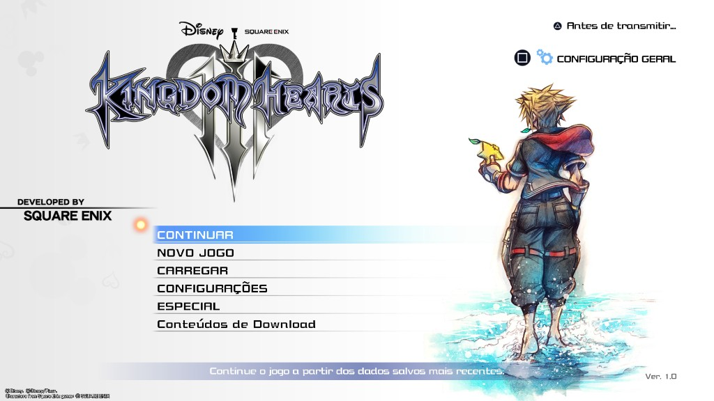
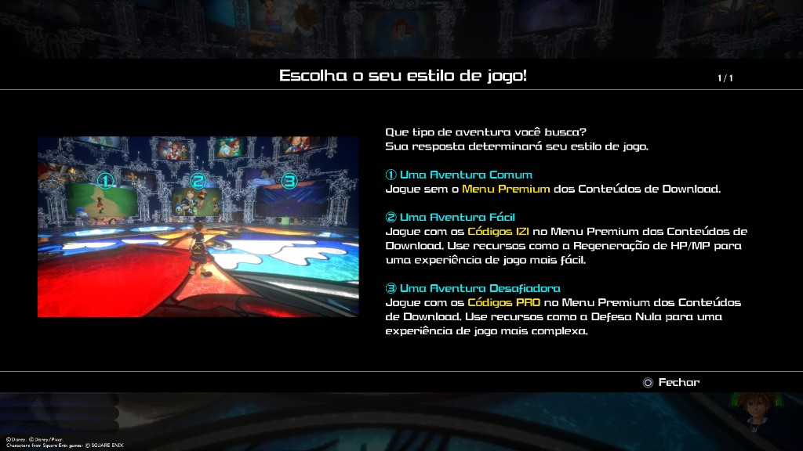
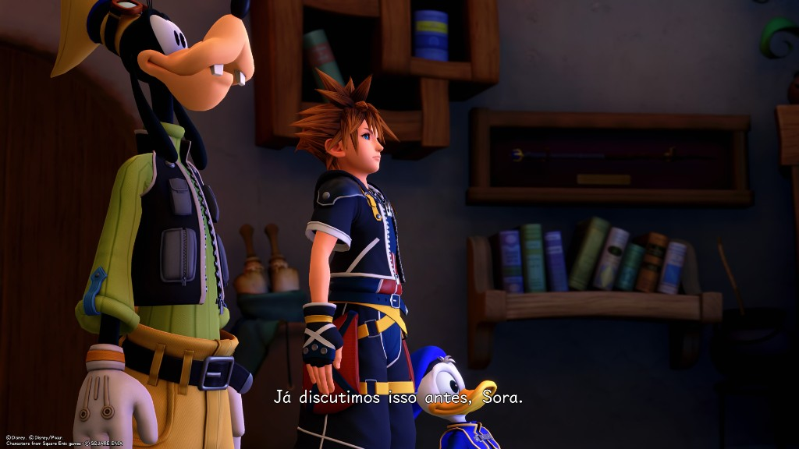
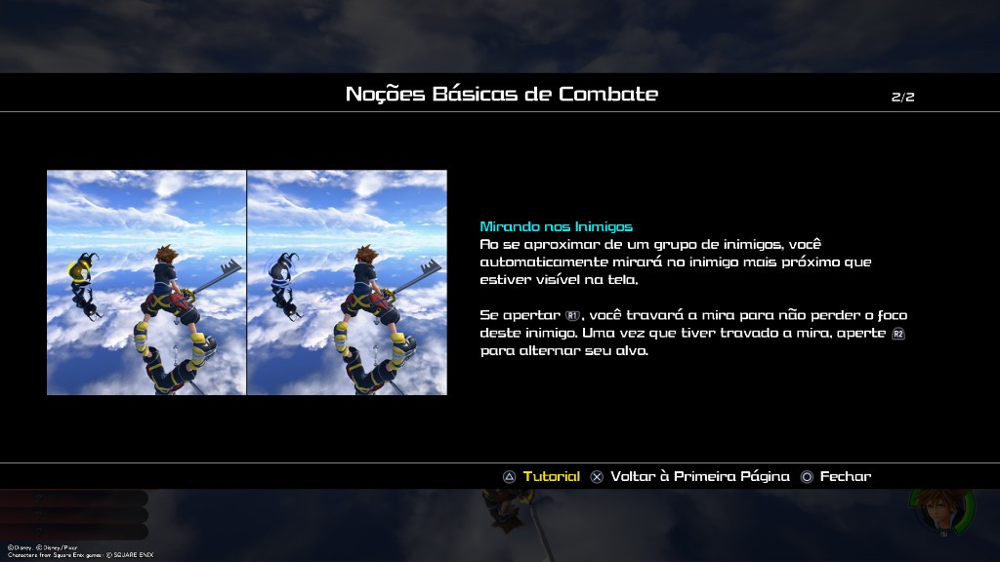

# Tradução PT-BR — Kingdom Hearts III + Re Mind (PS5, PPSA35999)

**Não inclui o jogo.** Só o `pakchunk0-ps5.pak` já traduzido e o instalador.

O texto é o da Phantasie Translate (Kingdom Hearts III + Re Mind, PC, 1.1.3): Sorinha e Andrea Phantasie, lleogame, LontraJogos e VSiFer. Este pacote só coloca esse texto no dump de PS5. Não é o instalador de PC da Phantasie.

## Screenshots






## Requisitos

- **Python 3 instalado no PC.** Baixe em https://www.python.org/downloads/ e, na instalação, deixe marcada a opção **Add python.exe to PATH**.
- Dump `PPSA35999-app0` com `tresgame\content\paks\pakchunk0-ps5.pak`.

## Como instalar

Mantenha juntos: `pakchunk0-ps5.pak`, `aplicar_traducao.py`, `aplicar_traducao.bat` e `aplicar_traducao.vbs`.

Dois cliques em `aplicar_traducao.py` (ou no `.vbs`) e escolha a pasta do jogo. Também dá para arrastar a pasta do jogo em cima do `aplicar_traducao.bat`.

```bat
aplicar_traducao.bat "D:\caminho\PPSA35999-app0"
```

O original do `pakchunk0` vai para a pasta **acima** do jogo, como `pakchunk0-ps5.pak.before-pt.bak`, para não entrar no que você envia ao console. Se esse backup já existir, ele é mantido.

Se o pak do jogo já for esta tradução, o instalador diz `ja aplicado, nada a fazer`.

## No console

O idioma do PS5 pode ficar em português. No jogo: **Configurações → Idiomas → Texto → Italiano**. O texto em português entra nesse slot. As vozes continuam inglês ou japonês. Áudio das cenas e imagens com texto desenhado não entram nesta tradução.
